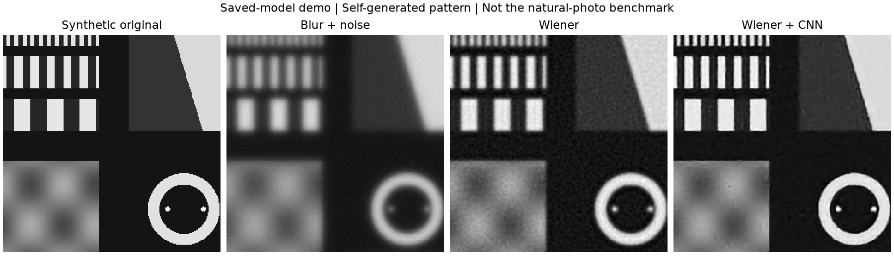

# AberraVision Lite

**固定失焦条件下的 AI 辅助图像复原。** 一个纯仿真的小型研究项目：从圆孔失焦 PSF 出发，比较 Wiener 与 Wiener＋轻量残差 CNN。

已完成数值检查、150 张照片的数据准备、验证选参、一次正式训练与 30 张独立保留照片的评价。没有真实光学硬件验证。本地报告和发布文件已准备；此目录尚未上传 GitHub。

## 结果

| 方法 | 平均 PSNR（dB）↑ | 平均 SSIM ↑ |
|---|---:|---:|
| 模糊观测 | 20.261 | 0.4859 |
| Wiener | 23.478 | 0.6511 |
| Wiener＋CNN | 25.067 | 0.7497 |

CNN 相对 Wiener 的平均改变量为 **+1.589 dB PSNR、+0.0986 SSIM**。PSNR 改善 30/30 张，SSIM 改善 30/30 张。这是本项目自定义划分和固定合成条件下的单次训练结果，不是 DIV2K 官方挑战成绩，也不代表真实镜头表现。

详细方法、逐图结果与限制见 [报告](report.md)、[评分 CSV](results/test/run_01/per_image.csv) 和 [配对改变量](results/test/run_01/paired_changes.png)。

## 快速演示

使用 Python 3.12。已附约 0.12 MB 级别的模型权重，无需训练或下载 DIV2K：

```bash
python3 -m venv .venv
.venv/bin/python -m pip install -r requirements.txt
.venv/bin/python demo.py
```

Windows 将 `.venv/bin/python` 替换为 `.venv\Scripts\python.exe`。结果位于 `results/demo/demo.png`。

也可打开 [demo.ipynb](demo.ipynb)，选择装有依赖的 Python 环境并在项目根目录运行；它读取模型，不自动重新训练。自生成图案仅用于演示，不算测试集。



## 重现正式实验

数据仅按 [DIV2K 官方使用条件](https://data.vision.ee.ethz.ch/cvl/DIV2K/) 获取，用途为学术研究。原图及照片衍生图不随发布文件提供。

```bash
.venv/bin/python scripts/fetch_dataset.py
.venv/bin/python scripts/prepare_dataset.py
.venv/bin/python scripts/freeze_data_split.py
.venv/bin/python scripts/select_wiener.py
.venv/bin/python train.py --output results/formal/reproduction
.venv/bin/python evaluate.py --checkpoint results/formal/reproduction/best.pt --output results/test/reproduction
```

下载约 671 MB 原图，另需场景数组空间。冻结步骤校验现有来源审核记录与数据指纹；如数据或依赖改变，需重新核查，不静默接受不同清单。运行目录必须为空；现有原始结果不会被覆盖。当前训练脚本不提供中断续训。`requirements-lock.txt` 保存本次完整 Python 包版本；跨平台结果仍可能存在数值差别。

正式协议是 [config.json](config.json) 和 [协议说明](docs/FORMAL_PROTOCOL.md)：100/20/30 张原图、a=0.15 waves、σ=0.01、K=0.01、28,641 参数、30 轮、按验证 L1 选第 25 轮。评分用相同中央 256×256，统一截断至 [0,1]，data_range=1，明确 SSIM 参数。

## 检查与学习

```bash
.venv/bin/python -m pytest -q
.venv/bin/python learn_optics.py --gallery
.venv/bin/python learn_wiener.py
```

检查覆盖 Airy 对照、卷积约定、PSF 采样及裁切、线性亮度预处理、数据划分、梯度学习、裁块与整图一致性、已知误差的 PSNR/SSIM。训练运行还核查权重重载与验证分数一致。

学习说明：[光学](docs/STEP_01.md) → [Wiener](docs/STEP_02_WIENER.md) → [数据](docs/STEP_03_DATA.md) → [选参](docs/STEP_04_VALIDATION.md) → [CNN 试跑](docs/STEP_05_CNN_PILOT.md)。

## 贡献、限制与发布

AI 助手大量协助实现、运行、解释和报告。用户的实际预测、观察、参数调整与学习反馈见 [PARTICIPATION.md](PARTICIPATION.md)。不将助手完成的工作写成用户独立完成，不把仿真写成硬件实验。

固定 PSF、固定噪声、周期边界、有限核裁切、小规模数据、单次正式训练均限制结论。权重用途和来源见 [模型说明](models/MODEL_CARD.md) 与 [第三方说明](THIRD_PARTY_NOTICES.md)。尚未替项目所有者选择源码许可证；公开仓库不等同于已授予开源复用许可。

项目按 [精简计划](RESEARCH_PLAN_LITE.md) 执行；早期教学记录保留历史状态，最新结果以本 README 和报告为准。
